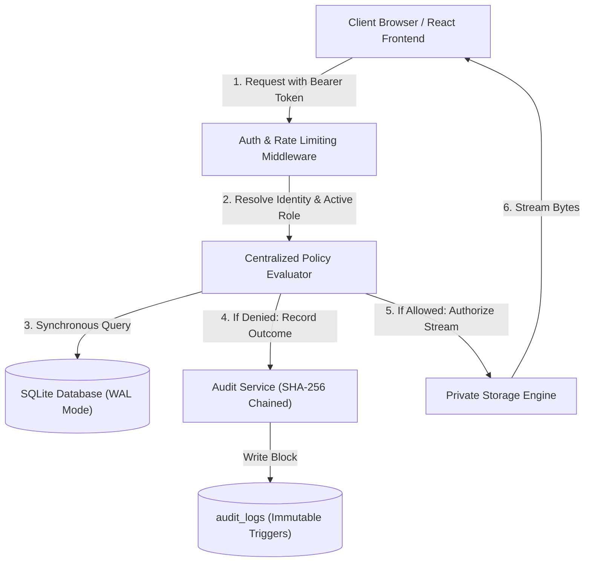

# TrustVault – Zero-Trust Confidential Document Sharing Platform

[](https://github.com/vijaychinthalapudi/TrustVault)
[](https://github.com/vijaychinthalapudi/TrustVault)
[](https://trustvault-rwsk.onrender.com/)

---

## 1. Executive Summary & Core Security Invariant

**TrustVault** is a zero-trust confidential document-sharing platform engineered to guarantee that:
1. **Zero Unauthorized Disclosure:** Only explicitly authorized identities can discover, access, download, or edit each document.
2. **Immediate Revocation:** Once an owner revokes a user's grant, or an administrator demotes an account, every subsequent request from that identity is blocked immediately.
3. **Tamper-Evident Audit Trail:** Every sensitive action (allowed and denied) is cryptographically chained using sequential SHA-256 blocks and protected by database-level immutability triggers.

### Core Security Invariant
> *"For every document operation, the server must identify the authenticated actor, load the requested resource, evaluate the actor's current permission for that exact resource and action, record the outcome, and only then return or change protected data."*

---

## 2. Seed Accounts & Evaluation Credentials

For evaluation convenience, the system is seeded with 4 distinct role accounts. The UI includes an **Evaluator Demo Switcher** above the login form for instant 1-click role testing:

| Role | Name | Email | Password | Intended Test Purpose |
|---|---|---|---|---|
| **ADMIN** | System Administrator | `admin@trustvault.local` | `Admin@TrustVault2026!` | View system audit trail, verify cryptographic SHA-256 chain, manage user roles. *Content download strictly blocked without grant.* |
| **OWNER** | Alice Jenkins (Finance Dir) | `alice@trustvault.local` | `Alice@TrustVault2026!` | Uploads files, grants READ/EDIT permissions to Bob, executes immediate revocations, soft-deletes files. |
| **VIEWER** | Bob Miller (Auditor) | `bob@trustvault.local` | `Bob@TrustVault2026!` | Granted `READ` on Financial Audit; `EDIT` on Security Baseline. Blocked from downloading confidential Term Sheet. |
| **VIEWER (Unrelated)** | Charlie Davis (Engineering) | `charlie@trustvault.local` | `Charlie@TrustVault2026!` | Zero grants. Used for negative testing, IDOR attack attempts, and verifying zero search leakage. |

---

## 3. Architecture & Data Flow



### Technology Stack:
- **Backend:** Node.js v24 LTS + Express + TypeScript
- **Database:** SQLite with `better-sqlite3` (WAL mode enabled, foreign keys enforced, database-level append-only triggers)
- **Cryptography & Security:**
  - Password Hashing: `bcryptjs` (12 rounds)
  - Sessions: Stateless HMAC-SHA256 JWT Bearer tokens with real-time database role re-verification
  - Audit Integrity: SHA-256 sequential cryptographic hash chaining
  - Security Headers: `helmet` (Strict CSP, HSTS, X-Content-Type-Options, Frameguard)
- **Frontend:** React 18 + Vite + Tailwind CSS + Lucide Icons + React Router
- **Testing:** Jest + Supertest (55 automated unit, integration, adversarial, and regression tests)

---

## 4. Key Security Controls & Defenses

1. **Server-Side Enforcement on Every Request:**
   Every API route (`/api/documents/:id`, `/api/documents/:id/download`, `/api/documents/:id/permissions`, `/api/admin/users/:id/role`, etc.) calls `PolicyEvaluator.evaluateDocumentAccess`. Hidden buttons in the UI are never trusted.
2. **Private Storage & Opaque Keys:**
   Uploaded files are stored outside the public web root in `server/storage/`. Files are renamed to opaque UUIDs (`<uuid>.bin`). Raw user filenames or local server paths are never revealed in responses.
3. **Binary Magic Byte Inspection:**
   File extensions and browser-supplied `Content-Type` headers are not trusted. The server inspects binary file headers (`%PDF-`, PNG, JPEG, DOCX zip headers) and unconditionally blocks executable headers (`0x4D 0x5A` DOS PE and `0x7F 0x45 0x4C 0x46` ELF).
4. **Zero Search & Metadata Leakage:**
   Search queries execute with real-time access filters in SQL. Non-grantees never receive titles, owners, or metadata of confidential documents they have no right to view.
5. **Immediate Revocation:**
   No pre-signed public links with long lifetimes. Downloads stream directly through authenticated endpoints that re-verify database permissions synchronously before byte streaming. A revoked grant takes effect on the immediate next request.
6. **Live Role Revocation & Ownership Decoupling:**
   When an Owner account is demoted to Viewer, existing unexpired tokens lose Owner privileges immediately. Document creators who are downgraded to Viewer cannot download their own files without an explicit permission grant, strictly enforcing Viewer policy.
7. **Append-Only Tamper-Evident Audit Trail:**
   Audit logs are protected by SQLite database triggers forbidding `UPDATE` and `DELETE`. Each event is hashed with the previous record's hash. The integrity verification endpoint recalculates the ledger from the genesis block.

---

## 5. Quickstart & Clean-Clone Reproducibility

### Prerequisites:
- Node.js >= 18 (Tested on Node.js v24.12.0)
- npm >= 9

### Step 1: Install Dependencies
```bash
# In the repository root
npm install
```

### Step 2: Seed the Database
```bash
# Initializes SQLite schema and seeds 4 test users, sample confidential files, grants, and cryptographic audit chain
npm run seed
```

### Step 3: Run the Automated Test Suite (55 Tests)
```bash
# Runs all 55 tests across 6 test suites with zero warnings
npm test
```

### Step 4: Run the Application
```bash
# Option A: Run Server (serves both API and pre-built frontend)
npm run build
npm start
# Navigate to http://localhost:5000

# Option B: Run Development Mode (concurrent server + Vite HMR)
npm run dev
# Frontend at http://localhost:3000 (proxies to http://localhost:5000)
```

---

## 6. Automated Test Suite Breakdown

Our test suite contains **55 passing tests** across 6 suites, asserting both positive and negative adversarial security behaviors:

```bash
PASS  tests/security.test.ts (17 tests)
  TrustVault Security & Access Control Invariants
    T-01: IDOR & Unauthorized Download Prevention
      ✓ denies unauthenticated user from downloading document bytes
      ✓ allows Bob to download DOC1 (has explicit READ grant)
      ✓ denies Charlie from downloading DOC1 (IDOR attempt: swapping document ID)
      ✓ denies Bob from downloading DOC2 (Alice owned, strictly confidential with no grants)
      ✓ denies Admin from downloading confidential document without explicit grant (Least Privilege)
    T-02: Privilege Escalation & Granular Rights Enforcement
      ✓ denies READ grantee from editing metadata or replacing file
      ✓ allows EDIT grantee to edit document metadata
      ✓ denies EDIT grantee from deleting the document (Owner only)
      ✓ denies non-owner from granting permissions to other users
    T-03: Upload Safety, Magic Bytes & Path Traversal Prevention
      ✓ rejects executable disguised as PDF (magic bytes mismatch)
      ✓ rejects path traversal in uploaded filename
      ✓ rejects disallowed file extensions (.sh, .exe, .bat)
      ✓ accepts legitimate genuine PDF file with opaque storage key generated server-side
    T-04: Audit Trail Immutability & Tamper Evidence
      ✓ denies non-admin users from accessing system-wide audit logs
      ✓ allows admin to view system audit logs
      ✓ verifies SHA-256 cryptographic chain integrity for audit logs
      ✓ enforces append-only trigger in SQLite rejecting direct UPDATE on audit_logs
      ✓ enforces append-only trigger in SQLite rejecting direct DELETE on audit_logs

PASS  tests/revocation.test.ts (2 tests)
  Immediate Revocation & Dynamic Permission Changes
    ✓ enforces immediate revocation: request starting after revocation commits is denied instantly
    ✓ supports atomic grant, upgrade, downgrade, and revocation lifecycle

PASS  tests/search-leakage.test.ts (4 tests)
  Search & Discovery Boundary (Zero Information Leakage)
    ✓ prevents non-grantees from discovering confidential document titles via search
    ✓ prevents category filter from leaking existence of confidential documents
    ✓ allows granted users to discover only their authorized documents in list/search
    ✓ ensures unrelated user sees zero documents in default document list

PASS  tests/role-management.test.ts (22 tests)
  Role Management & Registration Security Invariants
    Registration UI Security
      ✓ verifies registration page code contains no role selector or role options
    Unauthorized Role Modification Prevention
      ✓ denies unauthenticated requests to modify user roles
      ✓ denies Viewer from changing their own role (self-privilege escalation)
      ✓ denies Owner from changing anyone else role
      ✓ denies non-admin from listing all users
    Administrator Role Management & Invariants
      ✓ allows System Administrator to view registered users and their roles
      ✓ allows System Administrator to promote a Viewer to Owner
      ✓ prevents demoting the last active System Administrator
      ✓ rejects unsupported invalid role values
    Immediate Session Privilege Revocation
      ✓ immediately denies Owner-only operations to an existing session token when role is demoted to Viewer
      ✓ denies Viewer from performing Owner-only operations directly via the API
    Document Ownership Separation
      ✓ preserves existing document records and ownership intact when an account role is changed
    Audit Logging of Role Changes
      ✓ records an immutable, tamper-evident ROLE_CHANGE audit log with previous and new role
    Vivienne's Scenario: Downgrade from Owner to Viewer
      ✓ denies downgraded Vivienne from uploading new documents using her existing token
      ✓ denies downgraded Vivienne from editing Legal Notice using previous Owner privileges
      ✓ denies downgraded Vivienne from deleting Legal Notice
      ✓ denies downgraded Vivienne from managing sharing permissions (granting or revoking)
      ✓ denies downgraded Vivienne from inspecting permission grants or audit trail
      ✓ preserves document ownership record in database without automatic deletion or transfer
      ✓ enforces intended Viewer policy: denies download and discovery to Vivienne when she has no explicit grant
      ✓ allows authorized read access to follow the document permissions (Charlie has grant, Vivienne when granted)

PASS  tests/auth.test.ts (8 tests)
  Authentication & Identity Security
    ✓ allows valid user to sign in and returns JWT token
    ✓ rejects invalid password with safe error message and logs audit event
    ✓ rejects nonexistent user email safely without timing/enumeration leak
    ✓ enforces password complexity requirement during registration
    ✓ always assigns VIEWER role to newly registered users by default
    ✓ strictly ignores or rejects client-supplied elevated role (e.g. ADMIN or OWNER) during registration
    ✓ denies access to protected endpoint when token is missing
    ✓ denies access to protected endpoint when token is forged or malformed

PASS  tests/check-removal-regression.test.ts (2 tests)
  Authorization Regression: Check-Removal Exercise
    ✓ standard evaluation strictly denies unauthorized download attempt
    ✓ demonstrates that bypassing the owner/grant check immediately violates security invariant
```

### Check-Removal Exercise:
To verify that our automated tests catch regressions when a critical authorization check is removed:
```bash
npm run test:regression --workspace=server
```

---

## 7. Challenge Deliverables Reference

- **Threat Register:** [`THREATS.md`](file:///c:/Users/vijay/Downloads/Project-001/THREATS.md) — 18 adversarial threats analyzed, mitigated, tested, and mapped.
- **AI Usage Log:** [`PROMPTS.md`](file:///c:/Users/vijay/Downloads/Project-001/PROMPTS.md) — 9 dated technical entries detailing AI prompts, flawed proposals caught, corrections committed, and commit references.
- **API Documentation:** [`API.md`](file:///c:/Users/vijay/Downloads/Project-001/API.md) — Complete endpoint reference and authorization access matrix.

---

## 8. Public Live Deployment

- **Live URL:** [https://trustvault-rwsk.onrender.com/](https://trustvault-rwsk.onrender.com/)
- **Health Check API:** [https://trustvault-rwsk.onrender.com/api/health](https://trustvault-rwsk.onrender.com/api/health)
- **Deployment Platform:** Render Web Service
  - **Build Command:** `npm install --include=dev && npm run build && npm run seed`
  - **Start Command:** `npm start`
  - **Environment:** Node.js (Production, WAL-mode SQLite, served single-origin with Vite client bundle)
